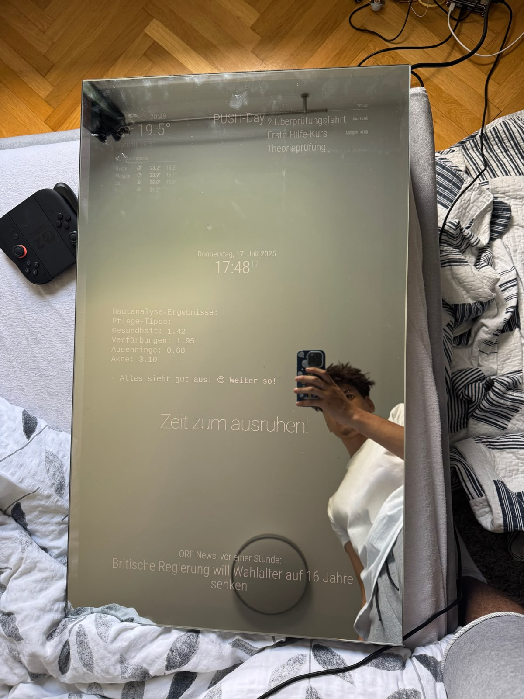

# Skin-Analysing Smart Mirror

A smart mirror that analyses your skin at the push of a button. A Raspberry Pi behind a two-way mirror takes a photo, sends it to the Face++ API and shows skin scores and care tips right in the mirror, next to the time, weather, news and your to-do list.

Built in summer 2025 on top of [MagicMirror²](https://github.com/MagicMirrorOrg/MagicMirror).



## What it does

- **Skin analysis on demand:** Press the button, the LEDs light your face evenly, the camera takes a photo and the mirror shows scores for skin health, stains, dark circles and acne, plus tips if something needs attention.
- **Wakes up when you walk by:** A motion sensor turns the mirror on through a Shelly smart plug and switches it off again after 5 minutes to save power.
- **Daily dashboard:** Clock, weather forecast, ORF news, compliments and Todoist tasks, using MagicMirror² modules.

## My contribution

MagicMirror² provides the display framework. Everything below is my own work:

| File | What it does |
| --- | --- |
| [`analyse.py`](analyse.py) | Waits for the button, switches the LEDs on, takes a photo with the Pi camera, resizes it if needed, sends it to the Face++ API and writes the results and tips to `face_result.txt`, which the mirror displays |
| [`bewegung_shelly.py`](bewegung_shelly.py) | Reads a PIR motion sensor and switches the Shelly Plug S on and off over its HTTP API |
| [`licht.py`](licht.py) | Toggles the LED lighting with a second button |
| [`compliments.json`](compliments.json) | Custom German messages for different times of day, such as "Push Day – gib alles heute!" on Mondays |

Plus the hardware build: mirror, Raspberry Pi, camera, buttons, LEDs, motion sensor and smart plug.

## How the skin analysis works

```
Button pressed
  → LEDs on, Pi camera takes photo, LEDs off
  → image resized if larger than 4096 px
  → POST to Face++ Detect API (skinstatus attribute)
  → scores compared with thresholds, tips generated
  → result written to face_result.txt
  → shown on the mirror
```

If no face is found, the mirror shows an error message instead of crashing, and the script keeps waiting for the next button press.

## Hardware

- Raspberry Pi with Raspberry Pi Camera (Picamera2)
- Monitor behind a two-way mirror
- 2 push buttons (analysis, light) and LED lighting, connected via GPIO
- PIR motion sensor
- Shelly Plug S smart plug

## Tech stack

Python (RPi.GPIO, Picamera2, Pillow, Requests) · Face++ API · Shelly HTTP API · MagicMirror² (Node.js) · Raspberry Pi OS

## Setup

1. Install [MagicMirror²](https://docs.magicmirror.builders/getting-started/installation.html) on the Raspberry Pi and enable the clock, weather, newsfeed, compliments and calendar modules. Use [`compliments.json`](compliments.json) for the compliments module.
2. Install the Python dependencies:
   ```bash
   pip install RPi.GPIO picamera2 pillow requests
   ```
3. Add your Face++ API key and secret in `analyse.py`, and your Shelly plug's IP address in `bewegung_shelly.py`.
4. Start the scripts:
   ```bash
   python3 analyse.py &
   python3 bewegung_shelly.py &
   python3 licht.py &
   ```

## Ideas for next steps

- Store results over time and show a trend chart of skin health
- Move API keys into environment variables
- Run the scripts as systemd services so they start on boot
